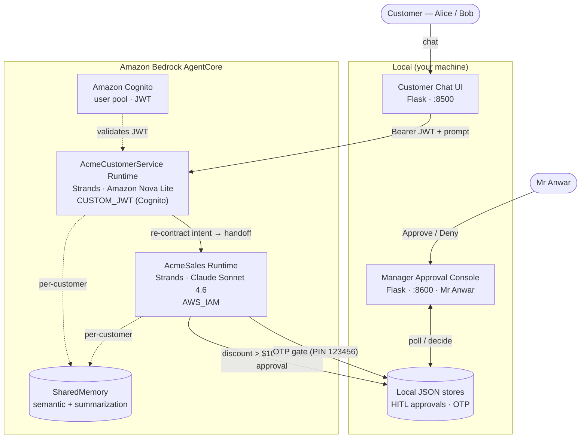
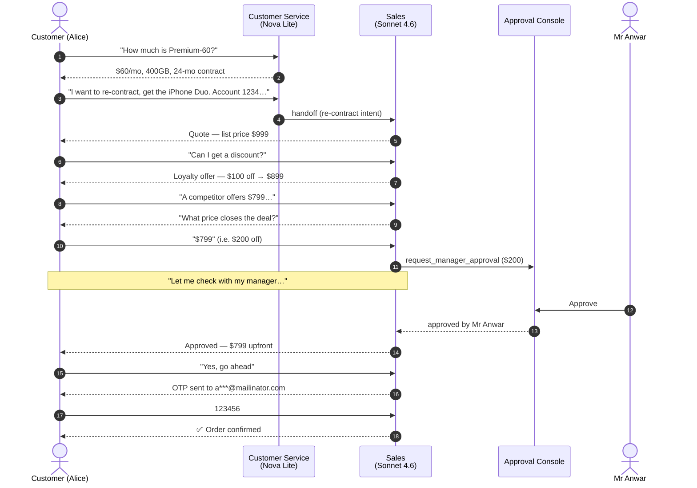
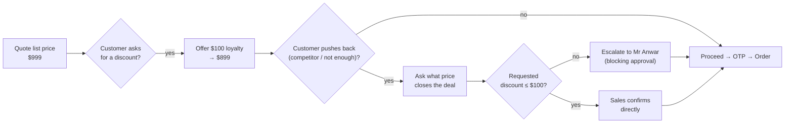

# 📡 Acme Telco — Customer Service & Sales Agents

> A multi-agent customer-support prototype on **Amazon Bedrock AgentCore**, built with the
> [Strands](https://github.com/strands-agents/strands-agents-builder) SDK. Two cooperating agents
> handle plan questions, device re-contracting, **human-in-the-loop discount approval**, and
> **email-OTP order verification** — with a responsive web chat and a manager approval console.

<p align="left">
  
  
  
  
  
</p>

---

## ✨ What it does

Acme Telco is a fictitious mobile operator. Two specialized agents collaborate:

| Agent | Model | Responsibilities |
| --- | --- | --- |
| **Customer Service** | Amazon Nova Lite | Answers plan / subscription-fee questions, identifies the customer by mobile or account number, and **hands off to Sales** when the customer wants to act on re-contracting. |
| **Sales** | Claude Sonnet 4.6 | Checks re-contract eligibility, negotiates device offers in stages, **auto-approves discounts up to $100**, escalates bigger discounts to a **human manager**, and verifies identity with an **email OTP** before placing the order. |

Highlights:
- 🤝 **Agent-to-agent handoff** — Customer Service routes re-contract requests to Sales, which keeps its own conversation state across turns.
- 🧑‍💼 **Human-in-the-loop** — discounts over $100 pause for a real manager decision in a web console, resolved within the same conversation.
- 🔐 **Two identity layers** — a JWT authorizes the runtime call; the *customer* is resolved in-chat and confirmed by OTP before any order.
- 🧠 **Memory** — AgentCore Memory (semantic + summarization) keyed per customer.
- 💬 **Responsive web chat** + a separate manager console.

---

## 🏗️ Architecture



> The two AgentCore **runtimes**, **memory**, and **Cognito** deploy to AWS. The web chat and the
> manager console are local Flask apps (AgentCore hosts agent runtimes, not web UIs). The HITL and
> OTP stores are local JSON files — no DynamoDB/SES — keeping the prototype inexpensive.

---

## 💬 The sales journey (end-to-end)



**Negotiation is staged** (anchoring like a real salesperson):



---

## 🧩 Design decisions

| Decision | Why |
| --- | --- |
| **Two separate runtimes** (not one agent) | Clear separation of concerns; Sales can use a stronger model and stricter auth. Mirrors a real org where Sales is a distinct team. |
| **Nova Lite for CS, Sonnet 4.6 for Sales** | CS is simple tool-driven Q&A (cheap model is plenty); Sales needs reliable multi-step negotiation + HITL + OTP reasoning. |
| **Handoff keeps Sales state across turns** | Negotiation spans several messages; the Sales conversation history is threaded through so context (device, prior offer) is preserved. |
| **HITL via a blocking tool + local store** | The manager decision resolves *within the same customer turn* — the agent pauses, polls the shared store, and resumes. A local JSON store keeps it $0 and dependency-free. |
| **Two identity layers (JWT + in-chat + OTP)** | The JWT secures the *endpoint*; the *business* identity (which Acme customer) is resolved conversationally and confirmed by OTP before an order — closer to how telco support actually works. |
| **Questions vs. actions routing** | "When can I re-contract?" is answered by Customer Service (it's a status question); only a clear intent to act ("I want to re-contract") hands off to Sales. |

---

## 📇 Seed data

| Customer | Account | Mobile | Email | Plan | Device / contract |
| --- | --- | --- | --- | --- | --- |
| **Alice Tan** | 123456789012 | 8123 4567 | alice.tan@mailinator.com | Premium-60 ($60/mo) | iPhone 16, 24-mo (2024-09-01 → 2026-08-31), **re-contract eligible** |
| **Bob Lee** | 987654321012 | 9876 5432 | bob.lee@mailinator.com | SIM-20 ($20/mo) | none — **upsell** → Premium-60 + device |

**Plans:** SIM-10/20/30 (SIM-only, no contract) · Basic-40 / Premium-60 / Ultimate-80 (postpaid, 24-mo).
**Devices:** DEV-DUO iPhone Duo Star White 512GB ($999) · DEV-PX Acme Pixel X ($699) ·
DEV-GS Acme Universe S ($899) · DEV-LT Acme Lite ($299).
**Discount:** ≤ $100 auto-approved; > $100 → Mr Anwar. **OTP:** fixed demo PIN `123456`, 6-digit, 3 attempts, 5-min expiry, masked email.

---

## 🚀 Quick start

### Prerequisites
- Python 3.13 · [uv](https://docs.astral.sh/uv/) · [AgentCore CLI](https://github.com/aws/agentcore-cli)
- AWS credentials with Amazon Bedrock access to **Amazon Nova Lite** and **Claude Sonnet 4.6**

### Setup
```powershell
uv venv --python 3.13 .venv
uv pip install --python .venv pytest strands-agents bedrock-agentcore pyjwt flask boto3 mcp
```

### Run the tests ($0, no Bedrock)
```powershell
.venv\Scripts\python.exe -m pytest tests -q
```
All business logic — identification, discount boundary, HITL, OTP, handoff, intent routing — is covered without calling a model.

### Run the live web chat
```powershell
# Terminal 1 — manager approval console
.venv\Scripts\python.exe app\ApprovalConsole\console.py        # http://localhost:8600/console

# Terminal 2 — customer chat portal
.venv\Scripts\python.exe app\AcmeCustomerService\frontend\frontend.py   # http://localhost:8500/
```
Open **http://localhost:8500/** → *Start chat*. Ask about a plan, then say you'd like to re-contract
and share an account/mobile number. For a discount over $100, Sales says it's checking with the
manager — **Approve** it in the console tab — then enter the OTP `123456` to confirm. Replies stream
from the real models (Nova Lite + Sonnet 4.6).

> The two runtimes also run under `agentcore dev` for hot-reload; the web chat drives the Customer
> Service agent in-process and reaches Sales via the handoff.

---

## ☁️ Deploy to AWS

Fill the placeholders first:

1. `agentcore/aws-targets.json` — set your 12-digit `<ACCOUNT_ID>` and region.
2. `agentcore/agentcore.json` — set the Cognito `discoveryUrl` (`<COGNITO_POOL_ID>`) and
   `allowedClients` (`<COGNITO_APP_CLIENT_ID>`), and the Sales runtime ARN env var
   (`<SALES_RUNTIME_SUFFIX>`, known after first deploy).
3. `app/AcmeSales/model/load.py` — confirm the Sonnet 4.6 inference-profile id for your region
   (`aws bedrock list-inference-profiles`).

```powershell
agentcore validate
agentcore deploy
agentcore status
```

**Identity model when deployed:** Customer Service uses **Cognito CUSTOM_JWT**; Sales uses **AWS_IAM**
and is invoked runtime-to-runtime (SigV4) by Customer Service's execution role (see
`app/AcmeCustomerService/invoke_sales_policy.json`).

---

## 🧹 Deprovision (do this after the demo)

```powershell
agentcore remove runtime AcmeCustomerService
agentcore remove runtime AcmeSales
agentcore remove memory SharedMemory
agentcore deploy          # applies the removals (tears down the AWS resources)
# or: cd agentcore/cdk ; npx cdk destroy
```
Then delete the Cognito user pool if you created one. Verify in the console that the runtimes and
memory are gone. Local runs never create AWS resources.

---

## 🗂️ Project layout

```
AcmeCustomerService/
├── agentcore/
│   ├── agentcore.json        # two runtimes + SharedMemory + CUSTOM_JWT (placeholders)
│   ├── aws-targets.json      # account + region (placeholders)
│   ├── cdk/                  # CDK app that synthesizes + deploys the config
│   └── .llm-context/         # read-only schema types for validation
├── app/
│   ├── AcmeCustomerService/  # Nova Lite runtime: plan Q&A, identify, handoff
│   │   ├── main.py · tools.py · handoff.py · auth_local.py
│   │   ├── model/load.py · memory/session.py
│   │   ├── data/ (plans, customers) · frontend/ (landing + chat)
│   │   └── invoke_sales_policy.json
│   ├── AcmeSales/            # Sonnet 4.6 runtime: eligibility, negotiation, HITL, OTP
│   │   ├── main.py · tools.py · sales_logic.py · handoff_runner.py
│   │   ├── data/devices.py · hitl/store.py · otp/verify.py
│   └── ApprovalConsole/      # Flask manager console (Mr Anwar)
├── scripts/demo_e2e.py       # scripted end-to-end journey
└── tests/                    # pytest suite (107 tests)
```

See [AGENTS.md](AGENTS.md) for invariants and the resource model.

---

## 🧪 Tech stack

**Strands Agents** · **Amazon Bedrock AgentCore** (CodeZip, Python 3.13) · **Amazon Nova Lite** +
**Claude Sonnet 4.6** · **Amazon Cognito** (CUSTOM_JWT) · **AgentCore Memory** · **Flask** (chat + console).

> This is a prototype. The blocking HITL holds the connection open while polling a local store;
> the OTP uses a fixed demo PIN. Both are deliberate simplifications for a $0, dependency-free demo.
